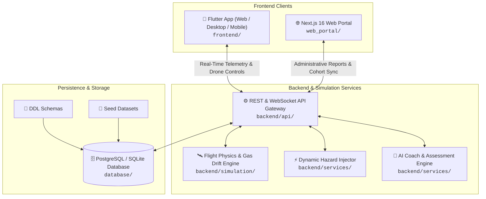

<div align="center">

# 🧠 SkillSense AI
### Intelligent Trainer Cockpit & Industrial Safety Operations Platform

<p align="center">
  <strong>Empowering industrial trainers with real-time drone telemetry, crisis simulation, skill gap analytics, and AI-driven trainee coaching.</strong>
</p>

<p align="center">
  <a href="https://web-zeta-black-29.vercel.app"></a>
  <a href="https://github.com/aditya-30-05/SkillSenseAI.git"></a>
  <a href="https://flutter.dev"></a>
  <a href="https://nextjs.org"></a>
  <a href="https://opensource.org/licenses/MIT"></a>
</p>

<p align="center">
  <a href="#-live-demo--preview">⚡ Live Demo</a> •
  <a href="#-key-features">✨ Key Features</a> •
  <a href="#-system-architecture">🏗️ Architecture</a> •
  <a href="#-monorepo-structure">🗂️ Monorepo</a> •
  <a href="#-getting-started">🚀 Quickstart</a> •
  <a href="#-tech-stack">🛠️ Tech Stack</a> •
  <a href="#-documentation">📑 Documentation</a>
</p>

---

</div>

## 📌 Executive Summary

**SkillSense AI** is a mission-critical industrial training and safety command platform. Built for hazardous industrial environments (refineries, chemical plants, welding bays, and gas infrastructure), SkillSense AI bridges the gap between simulated crisis scenarios and field operator readiness.

By combining **autonomous drone telemetry streaming**, **dynamic hazard injection**, and **real-time AI evaluators**, trainers can observe, stress-test, and certify field operators in realistic, zero-risk synthetic scenarios.

```
┌──────────────────────────────────────────────────────────────────────────────┐
│  SKILLSENSE AI // MISSION CONTROL TELEMETRY HUD                             │
├────────────────────┬─────────────────────────┬───────────────────────────────┤
│  ALTITUDE: 18.4 m  │  GROUND SPEED: 4.2 m/s  │  BATTERY: 82% [NORMAL]        │
│  ZONE: Bay B (Gas) │  RF LINK: -68 dBm       │  STATUS: HAZARD INJECTED ⚠️   │
├────────────────────┴─────────────────────────┴───────────────────────────────┤
│  SENSOR STREAMS:  CH₄: 320 PPM [CRITICAL] | TEMP: 28.4°C | RH: 54.1%        │
│  AI COACH:        "Rahul detected leak in 4.2s. Recommended RTH protocol."   │
└──────────────────────────────────────────────────────────────────────────────┘
```

---

## 🌐 Live Demo & Preview

Experience the platform live in your browser:

* **🚀 Production Web Application:** **[https://web-zeta-black-29.vercel.app](https://web-zeta-black-29.vercel.app)**
* **📦 Official Repository:** **[https://github.com/aditya-30-05/SkillSenseAI.git](https://github.com/aditya-30-05/SkillSenseAI.git)**
* **🔑 Quick Access:** Use the **1-Click Quick Demo** button on the login screen to sign in instantly with pre-seeded trainer telemetry and simulation datasets.

---

## ✨ Key Features

### 🛰️ 1. Real-Time Telemetry & Cockpit HUD
* **Dynamic Sensor Streams:** Live charts updating at 1 Hz for Gas Concentration (PPM), Ambient Temperature (°C), and Humidity (RH%).
* **Avionics Gauges:** Live altitude, ground speed, battery voltage, GPS coordinates, and signal dBm indicators.
* **Instant Abort & Return-to-Home (RTH):** Immediate override commands to safely bring drones to base in emergency simulations.

### ⚠️ 2. Real-Time Hazard Injection Engine
* **Interactive Crisis Scenarios:** Trigger live industrial anomalies on demand:
  * **Methane Spike ($CH_4$):** Sudden threshold exceedance in Zone B storage tanks.
  * **Toxic Hydrogen Sulfide ($H_2S$):** Critical lethal gas hazard requiring immediate PPE escalation.
  * **Carbon Monoxide Alert ($CO$):** Confined space combustion leakage.
* **Trainer Stress Testing:** Measure trainee reaction latency, procedural adherence, and hazard mitigation times under realistic pressure.

### 🗺️ 3. 2D Industrial Facility Radar & Hazard Map
* **Zoned Floorplan Blueprint:** Real-time visibility into Base Station, Zone A (Pipe Gallery), Zone B (Gas Storage), and Zone C (Welding Bay).
* **Animated Radar Pings:** Pulsing visual radar markers identifying active leaks, fire hazards, and structural defects.
* **Inspector Flyout Cards:** Drill down into verified PPM readings, timestamp logs, and responsible field personnel.

### 🤖 4. AI Coach & Intelligent Evaluator
* **Conversational Diagnostic Assistant:** Context-aware AI queries tailored to trainee performance (e.g., *"Why did Rahul lose points during the methane leak?"*).
* **Automated Scoring Breakdown:** Objective rubrics evaluating reaction latency, protocol compliance, PPE verification, and safety infractions.
* **1-Click Prompt Shortcuts:** Instant summaries, remediation roadmaps, and next-exercise recommendations.

### ⏱️ 5. Timeline Replay & Incident Scrubber
* **Step-by-Step Playback:** Revisit every mission phase from Takeoff $\rightarrow$ Hazard Injection $\rightarrow$ Sensor Spike $\rightarrow$ Trainee Detection $\rightarrow$ Mission Debrief.
* **Timeline Bookmarks:** Rapidly jump to critical decision points to conduct post-mission reviews with trainees.

### 👥 6. Trainee Directory & Competency Tracking
* **Comprehensive Profiles:** Trade badges (Gas Fitting, Plumbing, Welding, Electrical) and competency ratings (`Excelling`, `On Track`, `Needs Attention`).
* **Performance Sparklines:** Multi-session score trends, false alarm counters, and average reaction time metrics.
* **Leaderboard & Cohort Analytics:** Cohort learning curves, certified operator tallies, and gold/silver/bronze badges.

### 📜 7. Audit-Ready Certification & Reports
* **Session Evaluation Reports:** Comprehensive breakdown sheets for safety regulatory compliance.
* **Printable Certificates:** Instant pass/fail certificate previews equipped with tamper-evident QR verification stubs.

---

## 🎨 Industrial Cyber-Dark Design System

The SkillSense AI interface is engineered with a **dark-mode-first aesthetic** (`#0B0F19`) inspired by mission-control avionics and industrial telemetry dashboards:

| Color Token | Hex Code | Visual Role |
| :--- | :---: | :--- |
| **Obsidian Dark** | `#0B0F19` | Main viewport canvas, reducing fatigue in low-light operations |
| **Surface Dark** | `#111827` | Primary card elevations, bento-grid modules, and HUD containers |
| **Neon Cyan / Primary** | `#00D2B4` | Active state indicators, telemetry gauges, brand accents |
| **Hazard Critical Red** | `#EF4444` | High PPM gas warnings, emergency abort triggers, critical alarms |
| **Warning Amber** | `#F59E0B` | Cautionary thresholds, pending status, active hazard notices |
| **Operational Green** | `#10B981` | Safe PPM baselines, certified status, top cohort achievements |
| **Electric Blue** | `#2563EB` | Trainee identifiers, informational chips, secondary controls |

---

## 🏗️ System Architecture



---

## 🗂️ Monorepo Structure

```
SkillSenseAI/
├── 📱 frontend/              # Cross-Platform Flutter Client (Web, Desktop, Mobile)
│   ├── lib/                  # Dart source code
│   │   ├── app/              # Theme tokens, AppShell, responsive breakpoints
│   │   ├── core/             # System constants, mock stores, utility helpers
│   │   ├── features/         # 10 Domain screens (Dashboard, Live Monitor, Hazard Map, etc.)
│   │   ├── models/           # Domain entities (Trainee, Drone, Hazard, Telemetry)
│   │   ├── providers/        # Riverpod 2.6 reactive state management
│   │   ├── services/         # Real-time simulation ticker & telemetry generators
│   │   └── widgets/          # Reusable UI component library (Bento cards, Status chips)
│   ├── web/                  # Web configuration & PWA manifest
│   ├── android/ & ios/       # Native mobile platform wrappers
│   └── pubspec.yaml          # Flutter dependencies (fl_chart, riverpod, go_router)
│
├── 🌐 web_portal/            # Next.js 16 & React 19 Operations Management Portal
│   ├── app/                  # Next.js App Router pages and layouts
│   ├── components/           # Radix UI primitives & Lucide icons
│   └── package.json          # Node dependencies and scripts
│
├── ⚙️ backend/               # Backend Services & Telemetry Simulator
│   ├── api/                  # OpenAPI 3.1 REST & WebSocket API definitions
│   ├── simulation/           # Drone physics simulation & sensor drift engine
│   └── services/             # Microservices for telemetry ingest and AI coaching
│
├── 🗄️ database/              # Relational Schemas & Seed Data
│   ├── schemas/              # PostgreSQL & SQLite schema DDLs
│   ├── seeds/                # Structured JSON fixtures (trainees, sessions, hazards)
│   └── models/               # Mermaid ER diagrams & data dictionary
│
├── 📚 docs/                  # In-Depth Engineering Documentation
│   ├── frontend_report.md    # UI/UX audit, design system tokens, screen breakdowns
│   ├── architecture.md       # High-level architecture and microservice topology
│   └── README.md             # Documentation directory index
│
└── 🚀 vercel.json            # Vercel single-page application routing configuration
```

---

## 🛠️ Tech Stack

| Domain | Technology | Purpose |
| :--- | :--- | :--- |
| **Cockpit Client** | [Flutter 3.x](https://flutter.dev) / [Dart 3.5+](https://dart.dev) | High-performance, cross-platform client with 60 FPS charts |
| **State Management** | [Flutter Riverpod 2.6](https://riverpod.dev) | Reactive, compile-safe application state |
| **Data Visualization** | [fl_chart](https://pub.dev/packages/fl_chart) | Real-time multi-series sensor curves & area graphs |
| **Navigation** | [GoRouter 14](https://pub.dev/packages/go_router) | Declarative deep-linking and web route history |
| **Operations Web Portal** | [Next.js 16](https://nextjs.org) + [React 19](https://react.dev) | Modern server-rendered admin and management portal |
| **Simulation Engine** | [Python 3.11](https://python.org) | 1 Hz telemetry generation, waypoint routing, gas plume models |
| **Database** | [PostgreSQL](https://postgresql.org) / [SQLite](https://sqlite.org) | Relational storage for sessions, trainees, hazards, and audit logs |
| **Cloud Hosting** | [Vercel](https://vercel.com) | Edge-deployed static and web bundle hosting |

---

## 🚀 Getting Started

### Prerequisites
* **Flutter SDK:** `^3.5.0` or higher ([Install Flutter](https://docs.flutter.dev/get-started/install))
* **Node.js:** `^18.x` or higher ([Install Node.js](https://nodejs.org))
* **Python:** `^3.10` (for backend simulation engine)
* **Git:** Latest version

### 1. Clone the Repository
```bash
git clone https://github.com/aditya-30-05/SkillSenseAI.git
cd SkillSenseAI
```

### 2. Run the Flutter Frontend (Cockpit App)
```bash
# Navigate to the frontend directory
cd frontend

# Fetch dependencies
flutter pub get

# Launch on Chrome (Web)
flutter run -d chrome

# Or launch natively on Desktop
flutter run -d windows
```

### 3. Run the Next.js Operations Web Portal
```bash
# Navigate to web_portal directory
cd web_portal

# Install dependencies
npm install

# Start development server
npm run dev
# The web portal will be accessible at http://localhost:3000
```

### 4. Run the Backend Simulation Engine
```bash
# Navigate to the simulation engine
cd backend/simulation

# Run the simulation script
python simulation_engine.py
```

### 5. Database Initialization
```bash
# To initialize SQLite:
sqlite3 database/skillsense.db < database/schemas/schema.sql

# To initialize PostgreSQL:
psql -U postgres -d skillsense_db -f database/schemas/schema.sql
```

---

## 📑 Documentation

Explore detailed engineering reports and specs in the [`docs/`](docs/) directory:

* 📊 **[Frontend Architecture & UI/UX Audit Report](docs/frontend_report.md)**: Deep dive into 10 screens, 5,800+ lines of UI code, token standards, and responsive breakpoints.
* 🏗️ **[System Architecture](docs/architecture.md)**: Microservice data flows, client topologies, and telemetry pipelines.
* 🗄️ **[Database ER Diagram](database/models/er_diagram.md)**: Relational schema models, constraints, and seed structure.
* 🔌 **[Backend API Spec](backend/api/api_spec.json)**: OpenAPI 3.1 REST and WebSocket specifications.

---

## 🤝 Contributing

Contributions, feedback, and feature requests are welcome!

1. Fork the Project (`https://github.com/aditya-30-05/SkillSenseAI/fork`)
2. Create your Feature Branch (`git checkout -b feature/AmazingFeature`)
3. Commit your Changes (`git commit -m 'Add some AmazingFeature'`)
4. Push to the Branch (`git push origin feature/AmazingFeature`)
5. Open a Pull Request

---

## 📄 License

Distributed under the **MIT License**. See `LICENSE` for more information.

---

<div align="center">

**Developed with ❤️ for Next-Gen Industrial Safety Training**

[🌟 Star on GitHub](https://github.com/aditya-30-05/SkillSenseAI) • [🌐 Live Demo](https://web-zeta-black-29.vercel.app) • [📫 Report an Issue](https://github.com/aditya-30-05/SkillSenseAI/issues)

</div>
