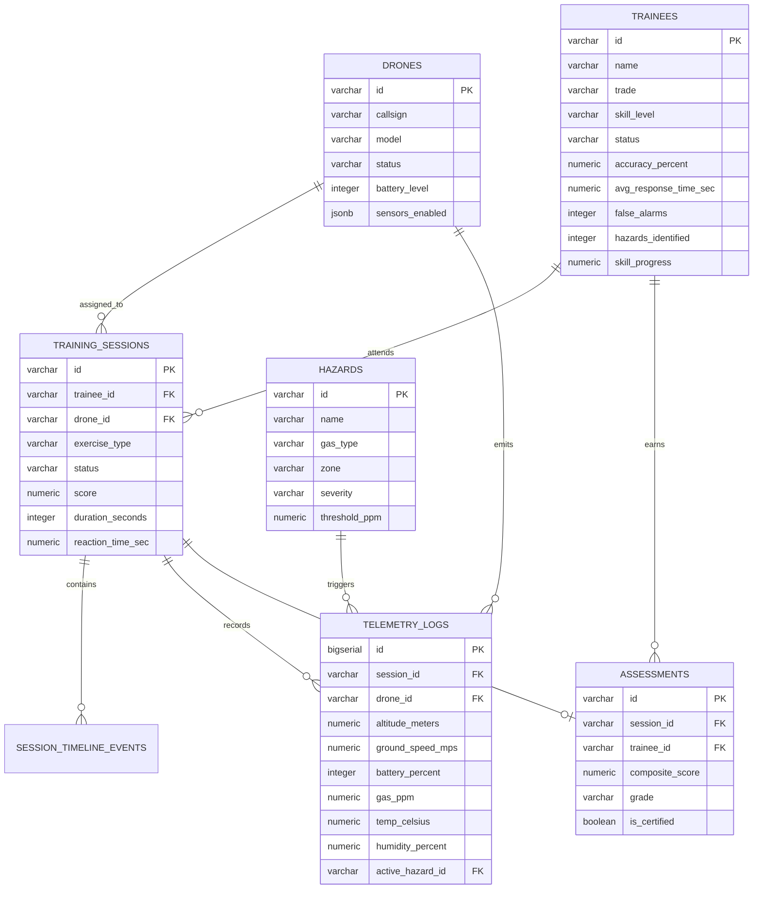

# SkillSense AI — Database Architecture & Entity Relationship Diagram

This document models the relational entities, keys, and foreign relationships powering the **SkillSense AI** platform.

## Entity Dictionary

1. **`trainees`**: Profiles, trade specialization (Gas Fitting, Plumbing, Welding, Electrical), historical accuracy metrics, and progressive skill mastery.
2. **`drones`**: Hardware specifications, operational statuses (`inFlight`, `standby`, `maintenance`), battery thresholds, and sensor payloads.
3. **`hazards`**: Industrial crisis definitions categorized by zone, gas chemical types (Methane, H2S, CO, VOC), and PPM trigger thresholds.
4. **`training_sessions`**: Flight exercise records, timing, trainee reaction latencies, and outcome scores.
5. **`telemetry_logs`**: High-frequency time-series telemetry streams logging altitude, speed, atmospheric gases, and environmental parameters.
6. **`assessments`**: Certification evaluations, weighted component grading, and formal trainer remarks.
