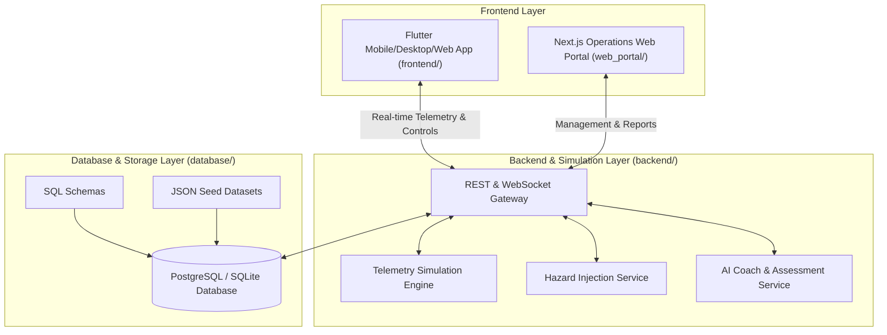

# SkillSense AI — System Architecture

## System Modules

1. **`frontend/`**: Flutter cross-platform trainer cockpit application featuring real-time HUD telemetry, hazard radar maps, interactive timeline replay, and trainee evaluation dashboards.
2. **`web_portal/`**: Next.js 16 / React 19 web application for administrators, trainers, and curriculum coordinators.
3. **`backend/`**: Real-time flight physics engine, telemetry generation, hazard injection orchestrator, and WebSocket communication gateway.
4. **`database/`**: Relational schema DDL, entity dictionaries, and JSON seed records.
5. **`docs/`**: UI/UX audit reports, development guidelines, and system diagrams.
